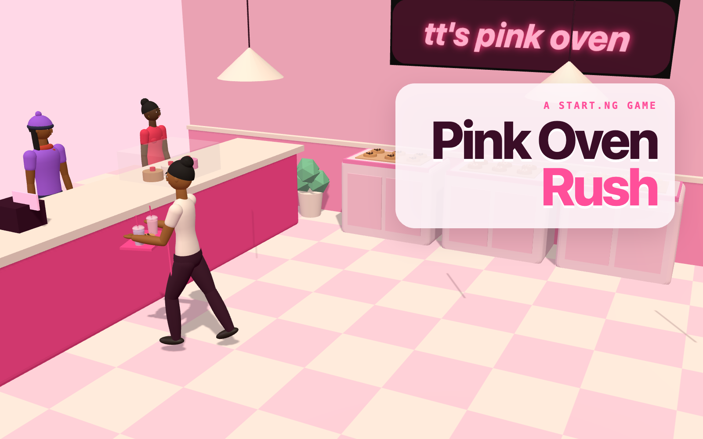

# Pink Oven Rush 🍪🧋

A 3D browser game for [start.ng](https://start.ng). You're on the counter at **tt's pink oven**: serve cookies and boba to the Lagos regulars before they lose patience.

**Play:** https://oven-rush.start.ng



## How to play

- A shift lasts **90 seconds**. You have **3 hearts**.
- Customers queue at the counter with an order on their ticket (1 to 3 items).
- Tap a **shelf** to pick up a cookie or a boba. The tray holds 3.
- Tap a **customer** (or their ticket) to serve them. Everything on your tray that's on their ticket goes to them.
- Fast serves earn **tips** and **combos**. A customer who runs out of patience storms off and costs a **♥**.
- Wrong items on the tray? Empty it in the **bin**.

| Action | Tap / click | Keyboard |
| --- | --- | --- |
| Pick up choc chip, biscoff, white choc | the cookie shelf | `1` `2` `3` |
| Pick up taro, strawberry, milk tea boba | the boba bar | `4` `5` `6` |
| Serve the customer at spot 1, 2, 3 | the customer or their ticket | `Q` `W` `E` |
| Empty the tray | the bin, or 🗑 on the tray bar | `X` |
| Pause | ❚❚ | `P` or `Esc` |

**Scoring:** 40 points per item, 60 per finished order, a tip of up to 80 for a fast serve (more from generous customers), and a combo bonus for finishing orders in a row while customers are still happy.

## How it uses start.ng

- **Your character is the baker.** The game asks start.ng who's playing and builds your start.ng character in 3D (body, colours, hair, hat and extra), with start.ng's own character code. The apron colour is a game-only extra you can pick on the menu.
- **Guests** play with start.ng's shared guest look and can sign in from the menu or the end screen.
- **Leaderboard:** signed-in players save their best shift (score, then orders served) to start.ng's shared board. Everyone can see the top 10.

## Run it locally

```bash
python3 -m http.server 8000
```

Then open http://localhost:8000. There's no start.ng here, so you play as a guest. Add `?debug` to the address to expose the game in the console as `window.ovenRush`.

## Files

| File | What it is |
| --- | --- |
| `index.html` | The page: menu, HUD, end screen; loads three.js 0.160.0 from jsDelivr |
| `src/main.js` | Sets up the scene, camera, input, labels, menu and start.ng flow |
| `src/game.js` | One shift: timer, hearts, customers, tray, serving and scoring |
| `src/world.js` | The bakery, the 3D cookies and boba, station positions and lights |
| `src/human.js` | start.ng's 3D character, ported to JavaScript, plus walking and carrying |
| `src/characters.js` | The customers: personalities, wants, surprises and lines |
| `src/items.js` | The menu items |
| `src/platform.js` | Talks to start.ng's connect page (who's playing, sign in, scores, leaderboard) |
| `src/style.css` | All the styles |
| `startng.json` | The leaderboard columns |
| `cover.png` | The 16:10 cover for start.ng |
| `tools/cover.html` | Renders `cover.png` from the real game scene |
| `PROJECT.md` | The full project guide |

Made by [Hassanat-t](https://github.com/Hassanat-t).
